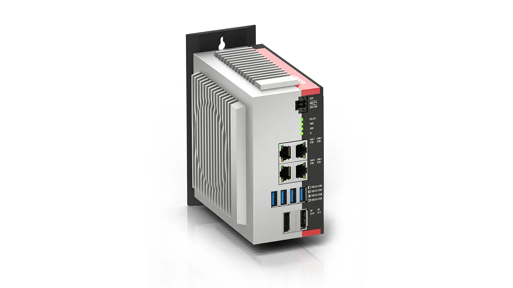
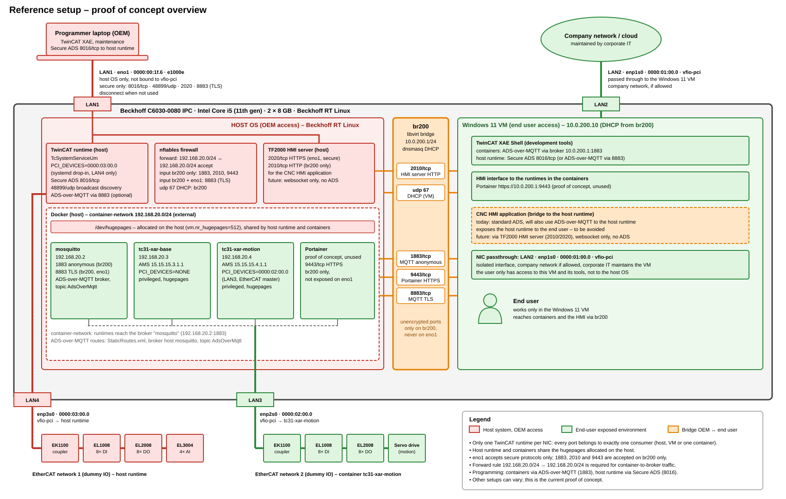
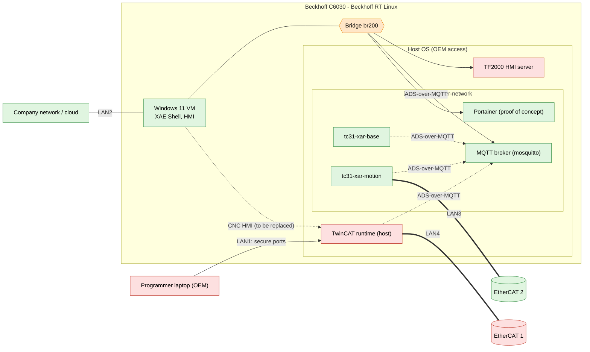

# Reference setup – overview

This document explains the proof-of-concept setup of the containerized TwinCAT runtimes on a Beckhoff IPC. It describes what runs where, who can access what, and how the parts are connected. Installation steps and command-line settings are not part of this document.

## Concept

One Beckhoff IPC runs Beckhoff RT Linux and hosts three kinds of environments side by side:

| Environment | Color | Who uses it |
|---|---|---|
| **Host system** (Beckhoff RT Linux, host TwinCAT runtime, HMI server, firewall) | red | OEM / machine builder only |
| **Windows 11 VM** and **TwinCAT runtimes in containers** | green | end user |
| **Bridge** between host and VM (`br200`) | orange | controlled connection between OEM and end user |

The end user works only inside the Windows 11 VM, with the development tools and the HMI. From there the user reaches the TwinCAT runtimes in the containers. The host system stays under control of the OEM.

## Hardware

| Item | Value |
|---|---|
| IPC | Beckhoff C6030-0080 |
| CPU | Intel Core i5, 11th generation |
| RAM | 2 x 8 GB |
| Storage | 80 GB SSD |
| OS | Beckhoff RT Linux |

### Network ports

| Port (rear view) | Interface | Used by |
|---|---|---|
| LAN1 (top left) | `eno1` | Host system: maintenance and programming with a programmer laptop. Accessible via secure protocols only, preferably disconnected when not in use. |
| LAN2 (top right) | `enp1s0` | Windows 11 VM (passed through). Connected to the company network, if allowed, and maintained by corporate IT. |
| LAN3 (bottom left) | `enp2s0` | EtherCAT network of a TwinCAT runtime in a container. |
| LAN4 (bottom right) | `enp3s0` | EtherCAT network of the TwinCAT runtime on the host. |

Every real-time Ethernet port is dedicated to exactly one consumer (host, VM or one container), so the runtimes cannot interfere with each other. The runtimes share the memory reserved for real-time Ethernet (hugepages) that is allocated on the host.

## Topology

Red: host system (OEM access). Green: end-user exposed environment. Orange: bridge between OEM and end user.

### Logical view

## Components

- **TwinCAT runtimes in containers:** each container runs its own TwinCAT runtime with its own AMS Net ID and IP address in the internal container network. Examples are `tc31-xar-base` and `tc31-xar-motion` (with motion control). A container can control its own EtherCAT network on a dedicated port.
- **MQTT broker (Mosquitto):** the container runtimes and TwinCAT Engineering communicate through this broker using ADS-over-MQTT. Unencrypted access is possible only through the internal bridge `br200`, encrypted access (TLS with user name and password) through the host network adapters.
- **TwinCAT runtime on the host:** controls the second EtherCAT network on its own port. It is reachable only via secure protocols.
- **TF2000 HMI server on the host:** serves the HMI via HTTPS to the network and via HTTP only to the VM through the bridge.
- **Windows 11 VM:** contains the TwinCAT development tools (XAE Shell) and the HMI to the runtimes in the containers. It is connected to the company network through its own network port and can be maintained by corporate IT.
- **Portainer:** installed as a proof of concept only, not in use. It is reachable from the VM only and not from the host network.

## Access and security

- The host network adapter (LAN1) accepts only secure protocols and is preferably disconnected when not in use.
- Unencrypted services (MQTT, HMI HTTP, Portainer) are reachable only through the internal bridge to the VM, never through the host network adapter.
- Today the containers are programmed via ADS-over-MQTT and the host runtime via Secure ADS. The host runtime can also be programmed via ADS-over-MQTT with the TLS port of the broker.
- The CNC HMI application in the VM currently reaches the host runtime via ADS. This exposes the host runtime to the end user. In the future an HMI server with a websocket connection only, without ADS, should replace this.

Other setups can vary. This document describes the current proof of concept.

## More information

Technical details and the commands to set up the host, the firewall, the real-time Ethernet ports and hugepages are in [reference-setup.md](reference-setup.md).
