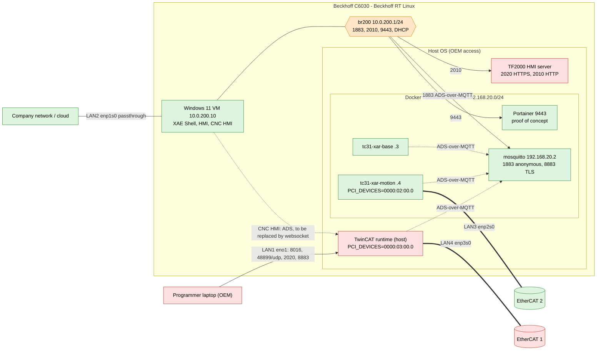

# Reference setup

The samples were developed and tested on this hardware.


## Hardware

| Item | Value |
|---|---|
| IPC | Beckhoff C6030-0080 |
| CPU | Intel Core i5, 11th generation |
| RAM | 2 x 8 GB |
| Storage | 80 GB SSD |
| OS | Beckhoff RT Linux |

## Overview

Topology of the proof of concept: red = host system (OEM access), green = end-user exposed environment, orange = bridges between OEM and end user. The editable SVG is [reference-setup-overview.svg](reference-setup-overview.svg).


### Logical view

Simplified, text-maintainable view of the same setup (no cables, EtherCAT IO or PCI details):


## Network interfaces

Output of `sudo TcRteInstall -l`:

```text
+-----+----------+-------------------+--------------+----------+----------+----------------------------------+------+
| No  | Name     | MAC               | Location     | Driver   | Override | Model                            | Link |
+-----+----------+-------------------+--------------+----------+----------+----------------------------------+------+
| 0   | enp3s0   | unknown           | 0000:03:00.0 | vfio-pci | [*]      | Ethernet Controller I226-IT      | un.. |
| 1   | enp2s0   | unknown           | 0000:02:00.0 | vfio-pci | [*]      | Ethernet Controller I226-IT      | un.. |
| 2   | enp1s0   | unknown           | 0000:01:00.0 | vfio-pci | [*]      | Ethernet Controller I226-IT      | un.. |
| 3   | eno1     | 00:01:05:a4:5f:56 | 0000:00:1f.6 | e1000e   | [-]      | Ethernet Connection (14) I219-LM | up   |
+-----+----------+-------------------+--------------+----------+----------+----------------------------------+------+
```

| Port (rear view) | Interface | PCI location | Driver | Use |
|---|---|---|---|---|
| LAN1 (top left) | `eno1` | `0000:00:1f.6` | `e1000e` | Host OS (Beckhoff RT Linux): maintenance / console / programming connection. Cannot be isolated from the host. Keep it disconnected from the network, except temporarily for those purposes. |
| LAN2 (top right) | `enp1s0` | `0000:01:00.0` | `vfio-pci` | Passed through to the Windows 11 VM. This is the port connected to the corporate network and is managed according to corporate IT rules. |
| LAN3 (bottom left) | `enp2s0` | `0000:02:00.0` | `vfio-pci` | Free to use, e.g. EtherCAT. Keep isolated from the corporate network. |
| LAN4 (bottom right) | `enp3s0` | `0000:03:00.0` | `vfio-pci` | Free to use, e.g. EtherCAT. Keep isolated from the corporate network. |

`[*]` in the `Override` column marks the NICs bound to `vfio-pci` (`enp1s0` for the VM, `enp2s0` and `enp3s0` for TwinCAT) with `sudo TcRteInstall -b <PCI device Location>`.

## Example: dedicated EtherCAT port for `tc31-xar-motion`

```bash
sudo PCI_DEVICES=0000:02:00.0 make SAMPLE=tc31-xar-motion restart-containers
```

Each real-time port can only be used by one runtime. If the TwinCAT runtime is also installed on the host, restrict it with `PCI_DEVICES` (e.g. `0000:03:00.0`, LAN4, or `NONE`) so it does not claim `0000:02:00.0`, and make sure hugepages are allocated on the host. See [the main README](../README.md#5-configure-real-time-ethernet-optional) and the [`tc31-xar-motion` README](../tc31-xar-motion/README.md#4-real-time-ethernet-ethercat).

## Advanced: separating Ethernet adapters between host, containers and VM

Every real-time Ethernet port is used by exactly one consumer. Configure the separation in three places:

1. **Bind the ports with `TcRteInstall`.** Bind each port that is not needed by the host network stack to `vfio-pci` (`sudo TcRteInstall -b <PCI device Location>`, check with `sudo TcRteInstall -l`). A bound port disappears from Linux networking. `eno1` (LAN1) stays with the host OS.
2. **Assign the ports to consumers.**

   | Port | Consumer | How |
   |---|---|---|
   | LAN1 `eno1` | Host OS | not bound to `vfio-pci` |
   | LAN2 `enp1s0` | Windows 11 VM | passed through to the VM, never listed in any `PCI_DEVICES` |
   | LAN3 `enp2s0` | Container, e.g. `tc31-xar-motion` | `PCI_DEVICES=0000:02:00.0` in the container's compose file |
   | LAN4 `enp3s0` | Host TwinCAT runtime (or a second container) | systemd drop-in with `PCI_DEVICES=0000:03:00.0` for the host, or `PCI_DEVICES` of the other container |

   A container with `PCI_DEVICES` unset probes all `vfio-pci` ports, and so does the host runtime `TcSystemServiceUm`. Always set `PCI_DEVICES` explicitly (`NONE` if no port is needed) so that no consumer claims a port of another.
3. **Restrict the host runtime with systemd.** Dedicate ports to the host runtime (or none) with a drop-in, and never list a port used by a container or the VM:

   ```bash
   sudo mkdir -p /etc/systemd/system/TcSystemServiceUm.service.d
   sudo tee /etc/systemd/system/TcSystemServiceUm.service.d/override.conf <<'EOF'
   [Service]
   Environment=PCI_DEVICES=0000:03:00.0
   EOF
   sudo systemctl daemon-reload && sudo systemctl restart TcSystemServiceUm
   ```

   Verify that the VFIO group of a container's port is not held by the host: `sudo fuser -v /dev/vfio/<n>`. Alternatively disable the host runtime with `sudo systemctl disable --now TcSystemServiceUm`.

### Hugepages on the host

The real-time Ethernet driver needs hugepages. They are allocated on the host and shared with the containers through the `/dev/hugepages` mount, so the pool must be large enough for the host runtime and all containers together:

```bash
grep -i huge /proc/meminfo                                               # HugePages_Total must be above 0
echo "vm.nr_hugepages=512" | sudo tee /etc/sysctl.d/90-hugepages.conf    # persistent
sudo sysctl --system
```

Without hugepages the container logs `EAL: Cannot get hugepage information.` and TwinCAT reports `Failed to connect to network adapter!`. A port claimed by two consumers fails with `EAL: Cannot open /dev/vfio/<n>: Device or resource busy`.

## Host runtime and HMI server on the host OS

In the reference setup `TcSystemServiceUm` and the TF2000 HMI server are also installed directly on the host OS, next to the containers:

- **Real-time Ethernet:** the host runtime uses only **one** NIC for EtherCAT, assigned with the `PCI_DEVICES` systemd drop-in (see above). The other `vfio-pci` ports belong to the containers and the VM.
- **Secure access only:** the host TwinCAT runtime is reachable only through secure ports. Open only these on the host firewall:

  | Port | Protocol | Purpose | Reachable from |
  |---|---|---|---|
  | 8016 | TCP | Secure ADS (host TwinCAT runtime) | engineering / corporate network |
  | 48899 | UDP | Broadcast discovery of the host TwinCAT runtime | engineering / corporate network |
  | 2020 | TCP | HMI server, HTTPS | engineering / corporate network |
  | 2010 | TCP | HMI server, local HTTP endpoint | **only the bridge adapter `br200`** (Windows 11 VM) |

  Port 2010 is unencrypted and must never be accepted on other interfaces, as for the broker port 1883 in the main README.
- **Containers do not conflict:** the containers use their own AMS Net IDs and addresses on `container-network` (see [SAMPLES.md](../SAMPLES.md)). The `tf2000-hmi-server` container sample publishes HTTPS port 2020 as well, so do not run it together with the host HMI server on the same port.

## Container network and firewall

All container samples share the Docker network `container-network` (`192.168.20.0/24`, addresses and AMS Net IDs in [SAMPLES.md](../SAMPLES.md)). The host firewall (nftables) must allow the traffic between the containers, for example a TwinCAT runtime connecting to the `mosquitto` broker, with this rule in the `forward` chain (`/etc/nftables.conf.d/`):

```nft
table inet filter {
  chain forward {
    ip saddr 192.168.20.0/24 ip daddr 192.168.20.0/24 accept
  }
}
```

The `forward` chain of Beckhoff RT Linux drops everything else. Without this rule the runtimes cannot reach the broker, even though all containers are healthy. If the subnet of `container-network` changes, adapt the rule. Reload with `sudo systemctl reload nftables` and then `sudo systemctl restart docker`, because the reload removes the Docker-managed rules. See [the main README](../README.md#2-set-up-firewall-rules-for-mqtt) for the complete rule set.

## Mosquitto broker access

The `mosquitto` broker container of the [`mosquitto-broker`](../mosquitto-broker/README.md) sample (`192.168.20.2` on `container-network`) is reachable from outside as follows:

| Port | Protocol | Reachable from | Use |
|---|---|---|---|
| 1883 | MQTT, anonymous, unencrypted | **only the bridge adapter `br200`** (Windows 11 VM) | ADS-over-MQTT |
| 8883 | MQTT over TLS, user name and password | `br200` and `eno1` | other secure MQTT communication, not ADS-over-MQTT |

`br200` and `eno1` are the only interfaces of the host network stack in this setup because the other ports are dedicated to EtherCAT (`vfio-pci`) or the VM. Other setups can vary, adapt the interfaces in the firewall rules accordingly.

Containers on `container-network` reach the broker directly through the forward rule above. The anonymous port 1883 must never be accepted on other interfaces than `br200`.

## Rule: network adapter of the host system

The network-attached adapter of the host system (`eno1`, LAN1) is only accessible via secure protocols (e.g. Secure ADS on 8016, HTTPS on 2020, MQTT over TLS on 8883) and should preferably be disconnected when not used. Unencrypted ports (1883, 2010) are never accepted on it, only on the internal bridge `br200`.

## How the runtimes are programmed

| Runtime | Connection from TwinCAT Engineering (current setup) |
|---|---|
| TwinCAT runtimes in containers | ADS-over-MQTT through the `mosquitto` broker (port 1883 on `br200`) |
| TwinCAT runtime on the host | Secure ADS on TCP port 8016 |

This can be changed: the host runtime can also be programmed via ADS-over-MQTT with the available broker, using the TLS port 8883 (user name and password) instead of 8016. The broker then also serves the host runtime, and port 8016 no longer needs to be open.

## Portainer (proof of concept)

Portainer is installed in the reference setup merely as a proof of concept and is not used. Installation: [portainer-and-containers.md](portainer-and-containers.md). It is reachable from the Windows 11 VM through the bridge adapter `br200` only (`https://10.0.200.1:9443`) and is **not exposed on the host system interface** (`eno1`). This needs specific firewall settings: accept the Portainer port only on `br200`, instead of the unrestricted rule in the installation guide:

```nft
table inet filter {
  chain input {
    iifname "br200" tcp dport 9443 accept
  }
}
```

Put it in a file in `/etc/nftables.conf.d/` (e.g. `61-portainer.conf`), then run `sudo systemctl reload nftables` and `sudo systemctl restart docker`.

## Windows 11 VM and end user access

- **Network:** only one isolated interface (LAN2, `enp1s0`) is passed through to the VM. It is the one connected to the company network, if allowed, and can be maintained by corporate IT. The VM reaches the host services via the bridge `br200` (see above).
- **Content:** the VM contains the development tools (TwinCAT XAE Shell) and the HMI interface to the runtimes in the containers.
- **End user:** the user has access only to the Windows 11 VM and the tools in it, not to the host OS.

### Host runtime for the CNC HMI application (current state and future)

| | Current / planned | Future |
|---|---|---|
| CNC HMI application | connects to the host runtime via standard ADS, and also via ADS-over-MQTT | HMI server, only a websocket is needed for communication, no ADS |
| Exposure | the end user in the VM can access the host runtime, although the end user should only be able to access the containers and the runtimes in them | the end user has no ADS access to the host runtime |

Providing ADS-over-MQTT access to the host runtime exposes it to the end user, which is not desired. This needs to be changed in the future by an HMI server that communicates with the browser or HMI client via websocket only (the TF2000 HMI server on the host, see above, is the starting point). Until then, treat the host runtime as accessible from the VM.
